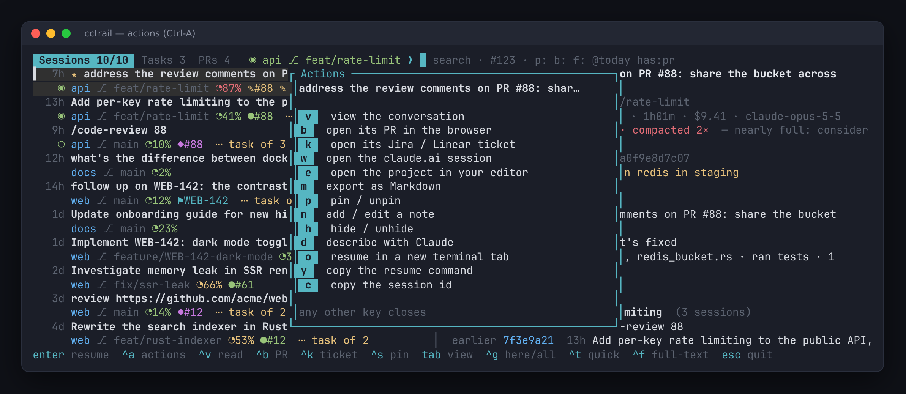
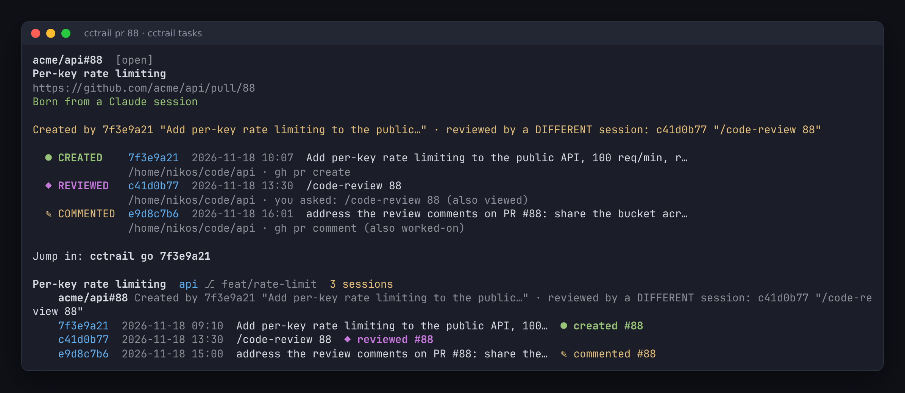
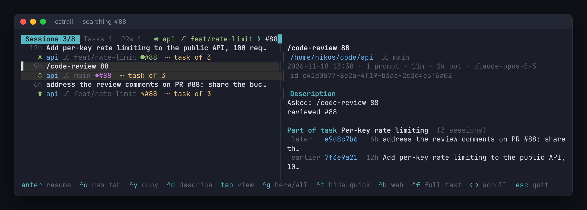
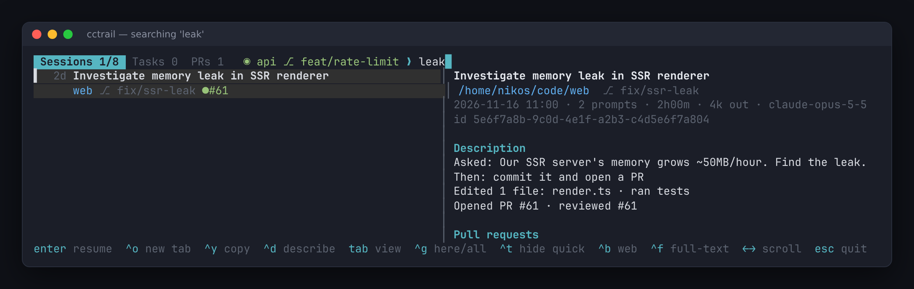

# cctrail

Find a Claude Code session in seconds, see what it did and which PRs it
**created** or **reviewed**, and jump straight back into it.


Type a few words (or `#123` for a PR), press **Enter**, and you're back in
that session: cctrail `cd`s into its directory and runs
`claude --resume <id>` for you. Started inside a repo, it puts that repo's
sessions first (◉ same branch, ○ same repo). Inside a repo, plain
`cctrail go` continues the latest session on your branch.

## What it gives you

- **A description for every session.** Each session gets one for free at
  index time: what you asked, what followed, which files were edited,
  whether tests ran, commits, and PRs. `cctrail describe` can also have
  Claude write a short title and summary (needs `ANTHROPIC_API_KEY`).
- **PRs born from Claude sessions.** cctrail reads the transcripts for
  `gh pr create`, `gh pr review/merge/comment`, `gh api …/pulls/…`,
  GitHub MCP tools (`create_pull_request`, `pull_request_review_write`, …),
  and prompts like `/review 42` or "review https://github.com/o/r/pull/7".
  Failed commands and text inside heredocs or quoted strings don't count.
- **PR lookup by number.** `cctrail pr 42` (or `#42`, `owner/repo#42`, or a
  PR URL) lists every session that touched the PR and says how.
- **Created by one session, reviewed by another, stated plainly.** The PRs
  tab tells each PR's story:

  

  You'll see one of: *"Created by A · reviewed by a DIFFERENT session: B"*,
  *"Created and reviewed in the SAME session"*, or *"Reviewed by B · created
  outside your Claude sessions"*. A session's detail view also says
  *"↳ created in another session: …"* next to PRs it only reviewed.
- **Context fill and cost per session.** Each session shows how full its
  context window was when it ended (◔ green under 50%, yellow under 80%, red
  above), how many times it was compacted, and what it cost, taken from
  Claude Code's own cost tally. A session at 87% is close to compacting
  again, so it's often better to start fresh than to resume it.
  `ctx:>80` finds those sessions.
- **Starts where you are.** Run it inside a repo and sessions from your
  current branch come first, then the rest of that repo, then everything
  else. `Ctrl-G` switches to plain newest-first.
- **Tasks: sessions that belong together.** Sessions that worked on the same
  branch, or on the same PR (created it, reviewed it, addressed the review),
  are grouped into one task. The Tasks view shows the whole story in order,
  and each session's preview lists its earlier and later sessions:

  

- **Filters you can type.** `p:api`, `b:feat`, `f:ratelimit.rs` (a file it
  edited), `repo:acme/web`, `has:pr`, `@today`, `@yesterday`, `@week`,
  `@3d`, and `#88`, all combinable with plain words. `Ctrl-T` hides one-off
  quick questions.

  

- **Read before you resume.** `Ctrl-V` opens the whole conversation
  (prompts, replies, tool calls; `o` shows tool output) with `/` search, so
  you can check it's the right session. Enter resumes it from there.

  

- **Jira and Linear tickets.** Keys like `ABC-123` are picked up from branch
  names (`feature/ABC-123-…`, `nikos/eng-42-…`), prompts and titles. They
  show as ⚑ badges, are searchable (type `ABC-123`), group sessions into
  one task, and `Ctrl-K` opens the ticket.
- **Pins, notes and cleanup.** `Ctrl-S` pins the sessions you're juggling to
  the top. Notes (`Ctrl-A n`) show in the preview and are searchable.
  Sessions you'll never need again can be hidden (`Ctrl-A h`).
- **One menu for everything else.** `Ctrl-A` lists every action for the
  selection: open its PR, ticket or claude.ai page, open the project in your
  editor, export as Markdown, describe with Claude, copy the id, and so on.

  

- **Claude can search your history too.** `cctrail mcp` is an MCP server,
  so inside a session you can ask *"how did we fix the redis bucket issue
  last time?"* (see [Use from Claude Code](#use-from-claude-code-mcp)).
- **Fast.** It's written in Rust: transcripts are parsed in parallel, and
  only files that changed are re-parsed, on every launch. Measured on 4 cores:

  | History | First index | Launch, nothing changed | Launch, a 14 MB session grew | Commands |
  |---|---|---|---|---|
  | 100 realistic sessions, 207 MB | 0.2 s | 1 ms | 33 ms | 7–14 ms |
  | 2,000 synthetic sessions, 641 MB | ~4 s | 10 ms | | |

## Install

You need a Rust toolchain ([rustup.rs](https://rustup.rs)).

```bash
cargo install --git https://github.com/nikostito/cctrail --locked
```

Or, from a clone, run `cargo install --path . --locked`. That puts a single
`cctrail` binary in `~/.cargo/bin`.

## Everyday use

| Command | What it does |
|---|---|
| `cctrail` | Open the picker |
| `cctrail go` | Inside a repo: continue the latest session on this branch (else this repo) |
| `cctrail go <words / id / #PR / filters>` | Jump straight in when there's exactly one match; otherwise open the picker with that query |
| `cctrail tasks` | Sessions grouped by task, with each one's role on the task's PRs |
| `cctrail pr 42` | Who created / reviewed / merged PR 42, then `cctrail go <id>` |
| `cctrail prs [--claude] [--repo web]` | PRs your sessions created or reviewed; `--claude` keeps only the ones born from a Claude session |
| `cctrail list [query] [-n 50] [-s]` | Recent sessions with descriptions, e.g. `cctrail list f:auth @week` |
| `cctrail search <words>` | Full-text search across every prompt, reply and shell command |
| `cctrail show <id>` | Everything about one session |
| `cctrail resume <id> [--tab \| --print]` | Resume here, in a new terminal tab, or just print the command |
| `cctrail view <id> [--outputs]` | Print the conversation (pipe to `less -R`) |
| `cctrail export <id> [-o file.md \| -o -]` | Summary, PRs, tickets, files and conversation as Markdown |
| `cctrail open <id \| #PR \| ABC-123> [--pr\|--ticket\|--cloud] [--print]` | Open the session's PR, ticket or claude.ai page |
| `cctrail pin <id>` / `unpin` · `note <id> [text]` · `hide <id>` / `unhide` | Your own marks; `note <id>` with no text clears it |
| `cctrail dir <id>` | Print the session's directory: `cd "$(cctrail dir a1b2)"` |
| `cctrail pick --print-dir` / `--print` | Pick interactively, print the directory / resume command |
| `cctrail shell-init zsh\|bash\|fish` | Key binding and `ccd` helper (see below) |
| `cctrail mcp` | MCP server for Claude Code (see below) |

Session ids can be abbreviated to their first few characters, like git
hashes.



### Picker keys

Typing `#88` keeps only the sessions linked to that PR, with the one that
created it first:



Plain words match titles, projects, branches, descriptions and prompts:



| Key | Action |
|---|---|
| typing | filter (fuzzy on title, project, branch, PR numbers; falls back to description and prompts) |
| `#42`, `acme/web#42`, PR URL | only sessions linked to that PR, creator first |
| `p:` `b:` `f:` `repo:` `has:pr` | project, branch, edited file, repo, did PR work |
| `@today` `@yesterday` `@week` `@month` `@3d` `@2w` | last active in that window |
| `ctx:>80`, `ctx:<30` | how full the context window was at the end |
| `ABC-123`, `t:abc-123` | sessions linked to that ticket |
| `is:pinned` `has:note` `is:hidden` | your marks (hidden sessions only show with `is:hidden`) |
| **Enter** | resume the session (in Tasks / PRs: list that task's or PR's sessions) |
| **Tab** / **Shift-Tab** | cycle Sessions → Tasks → PRs |
| `Ctrl-G` | toggle "here first" ranking (repo and branch you started in) |
| `Ctrl-T` | hide / show one-off quick sessions (1 prompt, no edits, no PRs) |
| `Ctrl-A` | actions menu for the selection (everything below, plus export, note, hide, copy id) |
| `Ctrl-V` | read the conversation (`/` find, `n`/`N` next/prev, `o` tool output, Enter resume, Esc back) |
| `Ctrl-K` | open the Jira / Linear ticket |
| `Ctrl-S` | pin / unpin |
| `Ctrl-E` | open the project in your editor (`$CCTRAIL_EDITOR`, `$VISUAL`, `$EDITOR`, else VS Code / Cursor / Zed) |
| `Ctrl-O` | resume in a new terminal tab (tmux, zellij, wezterm, kitty, iTerm2, Terminal.app, GNOME Terminal, Konsole, Windows Terminal, …) |
| `Ctrl-Y` | copy `cd … && claude --resume …` |
| `Ctrl-F` | toggle full-text search |
| `Ctrl-D` | have Claude describe the selected session |
| `Ctrl-B` | open the session's PR in your browser (else its claude.ai page) |
| `Ctrl-R` | re-index |
| `←` / `→` | scroll the preview |
| `Esc` | clear the query, or quit |

## AI descriptions

```bash
export ANTHROPIC_API_KEY=sk-ant-...
cctrail describe            # the 20 most recent sessions without one
cctrail describe --all      # every session that needs one
cctrail describe a1b2c3d4   # one session (or Ctrl-D in the picker)
```

Claude gets a compact digest of the session: your prompts, files edited,
PR roles, and the end of the last reply. It writes back a title of up to 8
words and a one- or two-sentence summary, which are cached in the index.
Sessions are described again only after they grow noticeably. The default
model is `claude-opus-5-5` at low effort; set `"describe_model"` in the
config or pass `--model` to change it.

## Cloud sessions (claude.ai/code) and GitHub sync

PRs opened from claude.ai cloud sessions carry a `claude.ai/code/session_…`
link in their body. With the [GitHub CLI](https://cli.github.com)
logged in:

```bash
cctrail sync                       # every repo seen in your sessions
cctrail sync --repo acme/web -n 500
cctrail pr 42 --sync               # refresh one PR
```

This fetches PR titles and state, and marks PRs whose body links a cloud
session, or carries the "Generated with Claude Code" footer, as **born from
Claude**, even when there's no transcript on this machine. It also links
sessions that worked on a PR's head branch.

## Shell integration

```bash
eval "$(cctrail shell-init zsh)"     # or bash; fish: cctrail shell-init fish | source
```

This gives you **Alt-S** to open the picker from any prompt, and
**`ccd [query]`** to pick a session and `cd` into its directory without
resuming it. `ccd` uses `cctrail pick --print-dir`; the picker draws on
stderr, so command substitution works.

## Use from Claude Code (MCP)

```bash
claude mcp add cctrail -- cctrail mcp
```

Claude then gets four tools that work on your local index:

| Tool | What it returns |
|---|---|
| `search_sessions` | Sessions matching a query (same syntax as the picker, or full-text) |
| `get_session` | Description, prompts, files, PRs (and who else created or reviewed them), notes, last reply, resume command |
| `read_transcript` | The conversation; with `query`, just the passages that mention it |
| `find_pr` | Which sessions created, reviewed or worked on a PR |

Ask things like *"find the session where we added rate limiting and tell me
how the bucket was shared"* or *"who reviewed PR 88?"*. It only reads
transcripts on your machine and re-indexes incrementally before each call.

## How tasks are formed

Two sessions land in the same task when they share a ticket key, or when they:

- worked on the same non-default branch (anything but `main`, `master`,
  `develop`, `dev` or `trunk`) of the same repo, or
- both did something concrete with the same PR: created, reviewed, merged,
  commented on, or worked on it.

The task's title is the PR title when one is known (after `cctrail sync`),
otherwise the branch name. Only groups of two or more sessions are listed.

## How detection works

| Role | Evidence |
|---|---|
| ● created | `gh pr create` (number taken from its output), `gh api -X POST repos/o/r/pulls`, MCP `create_pull_request`, or a synced PR whose body links this session |
| ◆ reviewed | `gh pr review`, review/comment POSTs to `…/pulls/N/reviews`, MCP review tools, `/review N` / `/code-review N`, or a prompt asking to review a PR |
| ✔ merged | `gh pr merge`, MCP `merge_pull_request` |
| ✎ commented | `gh pr comment`, `…/issues/N/comments`, MCP `add_issue_comment` |
| ↻ worked on | `gh pr checkout/edit`, MCP `update_pull_request`, PR activity subscriptions, "address the review comments on #N", or the PR's head branch |
| · viewed / mentioned | `gh pr view/diff`, MCP `pull_request_read`, PR URLs in prompts or replies |

A bare `#42` is resolved to a repo using, in order: `-R owner/repo`, the
session directory's `origin` remote, `git push` output in the transcript,
and other PR URLs in the same session.

## Configuration

`cctrail config` shows the paths in use. `~/.cctrail/config.json`:

```json
{
  "claude_projects_dir": null,
  "ignored_projects": [],
  "describe_model": "claude-opus-5-5",
  "context_windows": {},
  "tickets": {
    "ABC": "https://acme.atlassian.net/browse/{key}",
    "ENG": "https://linear.app/acme/issue/{key}"
  }
}
```

- `claude_projects_dir` defaults to `$CLAUDE_CONFIG_DIR/projects` or
  `~/.claude/projects`.
- `context_windows` overrides the context size used for the ◔ percentage,
  matched as a substring of the model id, e.g. `{"sonnet-4-5": 1000000}`.
  Built in: 1M for the Claude 5 family, Opus 4.6–4.8, Sonnet 4.6 and `[1m]`
  models; 200k for the rest.
- `tickets` maps a ticket prefix to its URL (`{key}` is replaced; `"*"`
  matches any prefix). Keys in branch names are always picked up. A key that
  appears only in a prompt counts when its prefix is listed here, or was seen
  in some branch name. That keeps things like `UTF-8` and `SHA-256` out.
- `cctrail ignore <substring>` / `cctrail unignore <substring>` stops (or
  resumes) indexing matching projects.
- `CCTRAIL_HOME` moves the index and config elsewhere.
- `--no-index` skips the automatic incremental index for one command.

The index is a SQLite file. Pins, notes and hidden flags live in their own
table and survive re-indexing. If Claude Code's retention deletes a transcript,
the session stays searchable but is marked *transcript deleted* and can't be
resumed.

## Limitations

- The JSONL transcript format is internal to Claude Code. Parsing is
  defensive, but a big format change may need a parser update.
- Role detection is evidence-based, not authoritative. A PR you reviewed by
  reading the diff in chat counts as *reviewed* only if you asked for a
  review, or the session posted one.
- Cloud-only sessions can't be resumed locally; `Ctrl-B` opens them on
  claude.ai.

## Development

```bash
cargo test
cargo clippy
cargo run --release -- list
CCTRAIL_TIMING=1 cargo run --release -- index --full   # time per indexing phase
```
