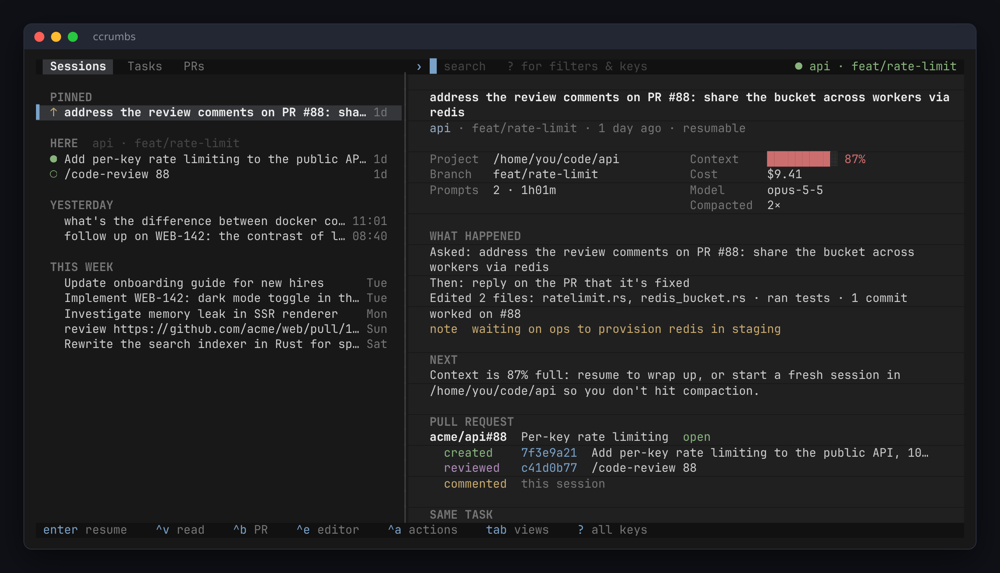
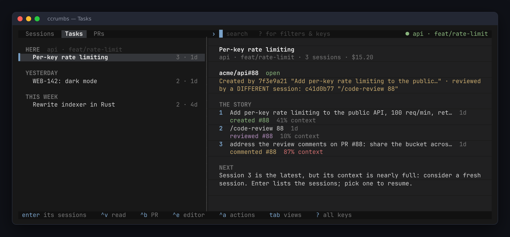
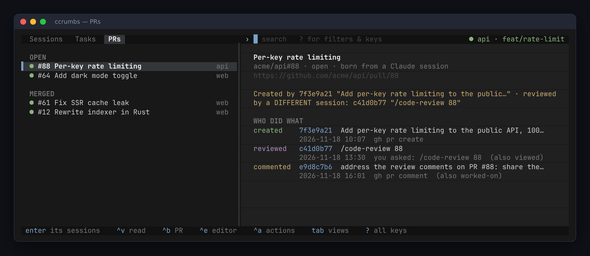
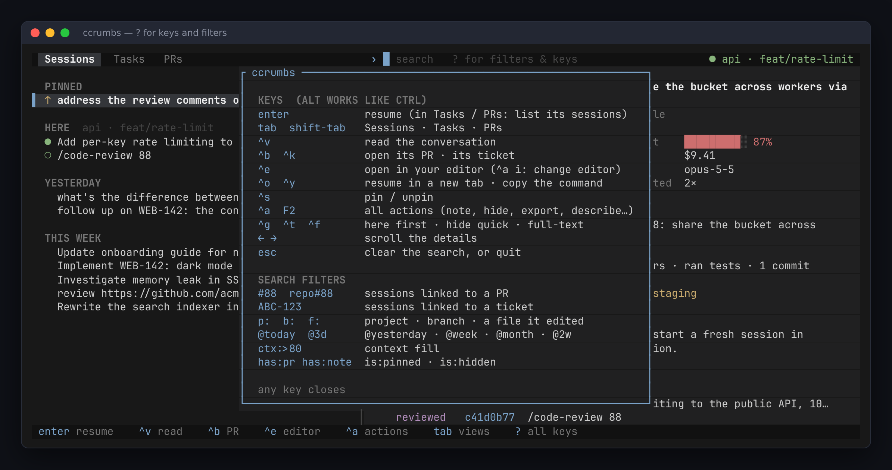
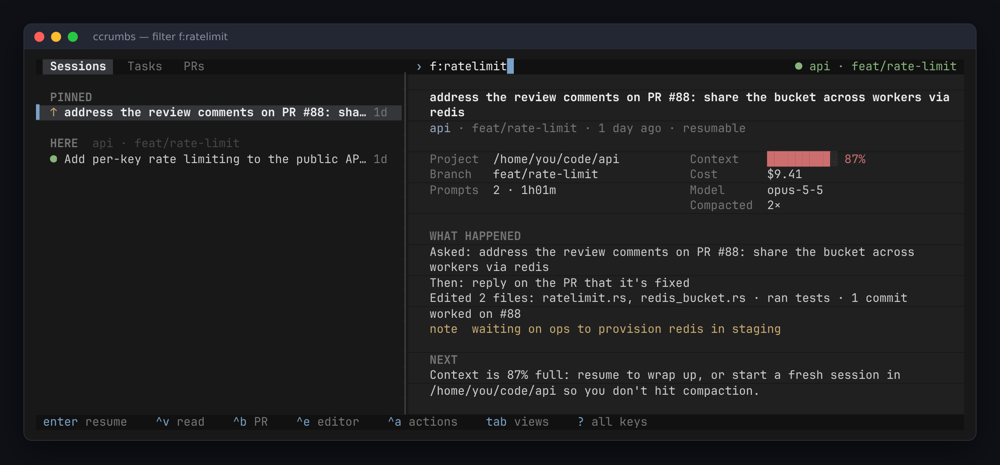
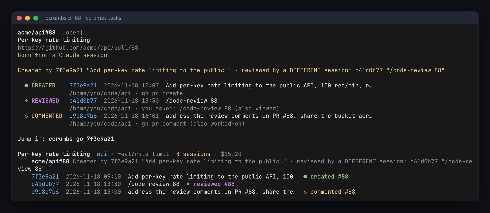
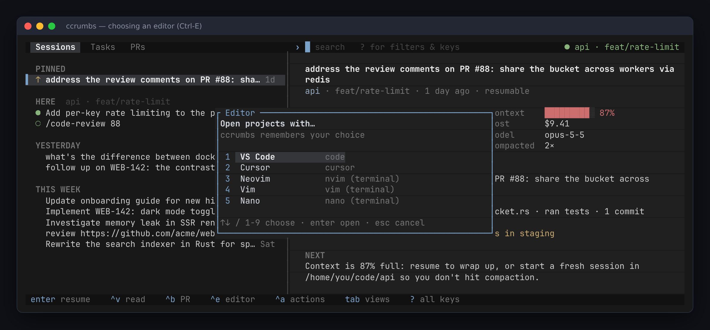
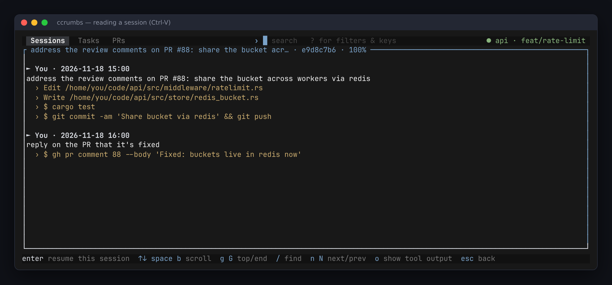

# ccrumbs

**Find a Claude Code session in seconds, see what it did and which PRs it
created or reviewed, and jump straight back into it.**



Claude Code keeps every conversation on disk, but finding *the* session you
want to continue means scrolling `claude --resume` or digging through JSONL
files. ccrumbs indexes them locally and gives you:

- **A picker that starts where you are.** Run it inside a repo and that
  branch's sessions come first. Type a few words, `#123` for a PR or
  `ABC-123` for a ticket, press **Enter**, and you're back in the session, in
  its directory.
- **A description of every session**: what you asked, what followed, files
  edited, tests run, commits and PRs. Optionally, Claude writes a short title
  and summary.
- **Which PRs came from Claude sessions, and who did what**, e.g. *"Created by
  session A · reviewed by a DIFFERENT session: B"*.
- **Tasks**: sessions that worked on the same branch, PR or ticket, grouped
  into one story.
- **Context fill and cost per session**, so you can tell whether to resume a
  session or start fresh.
- **A conversation viewer, notes, pins, Markdown export, Jira/Linear links,
  editor integration**, and an **MCP server** so Claude can search your past
  sessions too.

Everything runs locally. Nothing leaves your machine unless you use one of
the features listed under [Privacy](#privacy).

## Install

**Prebuilt binaries** for macOS (Apple Silicon and Intel), Linux (x86_64 and
arm64) and Windows are on the
[releases page](https://github.com/nikostito/ccrumbs/releases). Download one,
unpack it, and put `ccrumbs` somewhere on your `PATH`.

**With Cargo** (Rust 1.89 or newer):

```bash
cargo install ccrumbs --locked
```

or the latest code from GitHub:

```bash
cargo install --git https://github.com/nikostito/ccrumbs --locked
```

Then run:

```bash
ccrumbs
```

The first run indexes `~/.claude/projects`. That takes well under a second
for a typical history, or a few seconds if the files aren't in the disk cache
yet. After that, every launch only re-reads sessions that changed.

> **Coming from cctrail?** This project used to be called cctrail. Your index,
> pins, notes and settings in `~/.cctrail` are copied to `~/.ccrumbs`
> automatically the first time you run `ccrumbs`. The old `CCTRAIL_*`
> environment variables still work.

## The picker

The left side is a short list grouped as **Pinned**, **Here** (the repo and
branch you started in), **Today**, **Yesterday**, **This week** and older.
The right side is a card for the selected session:

- **Facts:** project, branch, prompts, a context bar, cost and model.
- **What happened**, and a **Next** hint when its context is nearly full.
- **Pull requests:** its PRs and who created and reviewed them.
- **Same task:** other sessions in the same task.
- **Files edited.**

Press **Tab** to switch between **Sessions**, **Tasks** and **PRs**:

| Tasks | PRs |
|---|---|
|  |  |

Press `?` (with an empty search) for every key and filter:



### Keys

| Key | Action |
|---|---|
| typing | search titles, projects, branches, PR numbers, tickets, descriptions and prompts |
| **Enter** | resume the session (in Tasks / PRs: list that task's or PR's sessions) |
| **Tab** / **Shift-Tab** | Sessions → Tasks → PRs |
| `^v` | read the whole conversation (`/` find, `n`/`N` next/previous, `o` tool output, Enter to resume) |
| `^b` / `^k` | open the PR / the Jira or Linear ticket in your browser |
| `^e` | open the project in your editor (asks which one the first time) |
| `^o` | resume in a new tab of your terminal |
| `^y` | copy `cd … && claude --resume …` |
| `^s` | pin / unpin |
| `^a` or `F2` | all actions: note, hide, export, describe with Claude, copy id, choose editor… |
| `^g` | toggle "sessions from here first" |
| `^t` | hide one-off quick sessions (one prompt, no edits, no PRs) |
| `^f` | full-text search over every prompt, reply and shell command |
| `^d` | describe the session with Claude |
| `^r` | re-index |
| `←` / `→` | scroll the card |
| `?` or `F1` | keys and filters |
| `Esc` | clear the search, or quit |

**Alt works like Ctrl** (`Alt-b` = `^b`). Use it when tmux, zellij or your
editor's terminal takes a Ctrl shortcut for itself.


### Search filters

Filters can be combined with each other and with plain words, in the picker,
`ccrumbs go` and `ccrumbs list`:

| Filter | Matches |
|---|---|
| `#88`, `acme/web#88`, a PR URL | sessions linked to that PR (the one that created it first) |
| `ABC-123`, `t:abc-123` | sessions linked to that ticket |
| `p:api` · `b:feat` · `f:ratelimit` | project · branch · a file the session edited |
| `repo:acme/web` | the session's GitHub repo |
| `@today` `@yesterday` `@week` `@month` `@3d` `@2w` `@12h` | last active in that window |
| `has:pr` · `has:note` · `is:pinned` · `is:hidden` | sessions with PR work · a note · pinned · hidden |
| `ctx:>80` · `ctx:<30` | how full the context window was at the end |



## Commands

| Command | What it does |
|---|---|
| `ccrumbs` | open the picker |
| `ccrumbs go` | inside a repo: continue the latest session on this branch (else this repo) |
| `ccrumbs go <words \| id \| #PR \| filters>` | jump straight in when exactly one session matches; otherwise open the picker with that query |
| `ccrumbs list [query] [-n 50] [-s]` | recent sessions with descriptions, e.g. `ccrumbs list f:auth @week` |
| `ccrumbs search <words>` | full-text search |
| `ccrumbs show <id>` | everything about one session |
| `ccrumbs pr 42` | which sessions created, reviewed or merged PR 42 |
| `ccrumbs prs [--claude] [--repo web]` | PRs your sessions worked on; `--claude` keeps the ones born from a Claude session |
| `ccrumbs tasks` | sessions grouped by task |
| `ccrumbs view <id> [--outputs]` | print the conversation |
| `ccrumbs export <id> [-o file.md \| -o -] [--force]` | the session as Markdown: summary, PRs, tickets, files, conversation |
| `ccrumbs open <id \| #PR \| ABC-123> [--pr\|--ticket\|--cloud] [--print]` | open the session's PR, ticket or claude.ai page |
| `ccrumbs resume <id> [--tab \| --print]` | resume here, in a new tab, or print the command |
| `ccrumbs pin` / `unpin` / `hide` / `unhide <id>` | your own marks |
| `ccrumbs note <id> [text]` | set a note (no text clears it); notes are searchable |
| `ccrumbs edit <id>` | open the session's project in your editor |
| `ccrumbs editor [set <name> \| reset]` | show or choose the editor (`set cursor`, `set pycharm`, `set "code -n"`) |
| `ccrumbs tickets [set <PREFIX> <url> \| remove <PREFIX>]` | Jira / Linear links |
| `ccrumbs sync [--repo owner/name]` | fetch PR titles and state from GitHub (needs `gh`) |
| `ccrumbs describe [<id> \| --all]` | AI titles and descriptions (needs an Anthropic API key) |
| `ccrumbs mcp` | MCP server for Claude Code |
| `ccrumbs shell-init zsh\|bash\|fish` | Alt-S key binding and a `ccd` helper |
| `ccrumbs completions <shell>` | tab completion for bash, zsh, fish, PowerShell or elvish |
| `ccrumbs dir <id>` | print the session's directory: `cd "$(ccrumbs dir a1b2)"` |
| `ccrumbs index [--full]` | re-index (runs automatically before every command) |
| `ccrumbs config` · `ignore <text>` · `unignore <text>` | show paths and settings · stop or resume indexing matching projects |

Session ids can be shortened to their first few characters (at least 4), like
git hashes.



## Pull requests

ccrumbs reads each transcript for evidence of what the session did with a PR:

| Role | Evidence |
|---|---|
| ● created | `gh pr create` (the number comes from its output), `gh api -X POST …/pulls`, the GitHub MCP tool `create_pull_request`, or a synced PR whose description links the session |
| ♦ reviewed | `gh pr review`, review POSTs to `…/pulls/N/reviews`, the MCP review tools, `/review N` or `/code-review N`, or a prompt asking for a review |
| √ merged | `gh pr merge`, MCP `merge_pull_request` |
| » commented | `gh pr comment`, `…/issues/N/comments`, MCP `add_issue_comment` (left out when the result shows the number is an issue, not a PR) |
| ► worked on | `gh pr checkout/edit`, MCP `update_pull_request`, "address the review comments on #N", or the PR's branch |
| · viewed / mentioned | `gh pr view/diff`, MCP `pull_request_read`, PR links in prompts or replies |

Text inside heredocs and quoted strings, and commands that failed, don't
count. A bare `#42` is matched to a repo using `-R owner/repo`, the session's
other PR links (so forks work), its directory's `origin` remote (SSH host
aliases included), or `git push` output.

`ccrumbs sync` uses the [GitHub CLI](https://cli.github.com) to fetch PR
titles and state. It also finds PRs opened from **claude.ai** web sessions:
those have the session link in their description, even when there's no
transcript on your machine.

## Tasks

Two sessions are part of the same task when they share a ticket key, worked
on the same branch (other than `main`, `master`, `develop`, `dev` or
`trunk`) of the same repo, or did something concrete with the same PR. The
Tasks view tells each task's story in order and suggests a next step. Each
session's card lists the other sessions in its task.

## Tickets (Jira, Linear, …)

Keys like `ABC-123` are picked up from branch names (`feature/ABC-123-login`,
`you/eng-42-dark-mode`), prompts and titles. They show on the session card,
are searchable, and group sessions into tasks. Press `^k` to open one. The
first time you do, ccrumbs asks for your tracker's address. You can paste
your Jira site, your Linear workspace or any ticket link, or set it ahead of
time:

```bash
ccrumbs tickets set ABC https://yourcompany.atlassian.net
```

```bash
ccrumbs tickets set ENG https://linear.app/yourteam
```

`ccrumbs tickets` shows the links you've set and the ticket prefixes in your
sessions that have none. A key in a branch name is always used. A key that
only appears in a prompt is used when its prefix has a link or appears in
some branch name; that keeps things like `UTF-8` out.

## Editors and terminal tabs

`^e` (or `ccrumbs edit <id>`) opens the project in your editor. The first
time, ccrumbs lists the editors it finds and remembers your choice: VS Code,
Cursor, Windsurf, Zed, Sublime Text, JetBrains IDEs, Neovim, Vim, Helix,
Emacs and others. On macOS, that includes apps without their command-line
launcher installed. Terminal editors take over the screen until you quit
them.



`^o` opens a new tab in the terminal you're using and resumes the session
there. That works in tmux, zellij, WezTerm, kitty, iTerm2, Terminal.app,
Ghostty, Warp, GNOME Terminal, Konsole, xfce4-terminal and Windows Terminal.

- **Terminal.app, Ghostty and Warp:** ccrumbs presses ⌘T for you, so macOS
  asks once to allow your terminal under *Privacy & Security →
  Accessibility*.
- **Anywhere else**, `^y` copies the command instead.

## Reading, notes, export

- `^v` opens the whole conversation, with search. Press Enter there to
  resume.

  

- Notes (`^a n`) appear on the card and are searchable. Pins (`^s`) keep the
  sessions you're juggling at the top. Hiding (`^a h`) removes a session from
  lists and search; `is:hidden` shows hidden sessions again.
- `ccrumbs export <id>` writes the session as Markdown, ready for a PR
  description, a ticket or a teammate.

## AI descriptions

```bash
export ANTHROPIC_API_KEY=sk-ant-...
```

```bash
ccrumbs describe             # the 20 most recent sessions without one
ccrumbs describe --all       # every session that needs one
ccrumbs describe a1b2c3d4    # one session (or ^d in the picker)
```

Claude reads a compact digest of the session and writes a title of up to 8
words and a one- or two-sentence summary. The digest has the project and
branch, your first prompts, files edited, PR roles and the end of Claude's
last reply. Results are cached, and a session is described again only after
it grows noticeably.

- **Model:** `claude-opus-5-5` at low effort. Change it with `--model`, or
  set `"describe_model"` in the config.
- **Cost:** API calls are billed to your key. Use `-n` or a single id to stay
  in control.

## Use from Claude Code (MCP)

```bash
claude mcp add ccrumbs -- ccrumbs mcp
```

Claude gets four tools that read your local index:

| Tool | Returns |
|---|---|
| `search_sessions` | sessions matching a query (the same syntax as the picker, or full-text) |
| `get_session` | description, prompts, files, PRs (and who else created or reviewed them), notes, last reply, resume command |
| `read_transcript` | the conversation; with `query`, only the passages that mention it |
| `find_pr` | which sessions created, reviewed or worked on a PR |

Then ask things like *"find the session where we added rate limiting and tell
me how the bucket was shared"* or *"who reviewed PR 88?"*.

## Shell integration

```bash
eval "$(ccrumbs shell-init zsh)"      # or bash; fish: ccrumbs shell-init fish | source
```

This gives you **Alt-S** to open the picker from any prompt, and **`ccd
[query]`** to pick a session and `cd` into its directory without resuming it.
For tab completion:

```bash
ccrumbs completions zsh > ~/.zfunc/_ccrumbs   # bash, fish, powershell, elvish too
```

## Configuration

`ccrumbs config` shows the paths in use. `~/.ccrumbs/config.json` (every key
is optional):

```json
{
  "claude_projects_dir": null,
  "ignored_projects": [],
  "describe_model": "claude-opus-5-5",
  "theme": "dark",
  "editor": "cursor",
  "tickets": { "ABC": "https://yourcompany.atlassian.net/browse/{key}" },
  "context_windows": {}
}
```

| Key | Meaning |
|---|---|
| `claude_projects_dir` | where the transcripts are; default `$CLAUDE_CONFIG_DIR/projects` or `~/.claude/projects` |
| `ignored_projects` | path fragments to never index (`ccrumbs ignore <text>`) |
| `describe_model` | model for `ccrumbs describe` |
| `theme` | `"dark"` (the default; its own gray-black colours, the same in any terminal) or `"terminal"` (your terminal's palette) |
| `editor` | set when you choose one; any shell command, with the project folder added at the end |
| `tickets` | ticket prefix → URL with `{key}`; `"*"` applies to every prefix |
| `context_windows` | override the context size used for the context %, by model id fragment, e.g. `{"sonnet-4-5": 1000000}` (built in: 1M for current models, 200k for older ones) |

If the file doesn't parse, ccrumbs says so and won't overwrite it.

| Environment variable | Meaning |
|---|---|
| `CCRUMBS_HOME` | where the index and config live (default `~/.ccrumbs`) |
| `CCRUMBS_EDITOR` | editor to use when none is chosen in the config |
| `CCRUMBS_TIMING=1` | print how long each indexing phase takes |
| `CLAUDE_CONFIG_DIR` | Claude Code's config folder (transcripts are in its `projects/`) |
| `ANTHROPIC_API_KEY` / `ANTHROPIC_AUTH_TOKEN`, `ANTHROPIC_BASE_URL` | for `ccrumbs describe` |
| `NO_COLOR` | plain output from the command-line commands |

## Privacy

ccrumbs reads Claude Code's transcripts and writes only to `~/.ccrumbs`
(`index.db`, `config.json`, and `exports/` when you export from the picker).
It sends no telemetry. Data leaves your machine only when you use one of
these features:

- **`describe` / `^d`:** sends a digest of the session (prompts, file names,
  PR numbers, the end of the last reply) to the Anthropic API with your key.
- **`sync` / `pr --sync`:** calls GitHub through your `gh` login, to read PR
  metadata of repos found in your sessions.
- **`open`, `^b`, `^k`:** open URLs in your browser.
- **`mcp`:** answers the Claude Code session it's attached to; that session's
  data handling applies to what Claude reads.

## Performance

ccrumbs is written in Rust and parses transcripts in parallel. Only files
that changed are re-read, so it re-indexes on every launch. Measured on 4
cores with a warm disk cache:

| History | First index | Launch, nothing changed | Launch, a 14 MB session grew | Commands |
|---|---|---|---|---|
| 100 realistic sessions, 207 MB | 0.25 s | 1 ms | 40 ms | ~10 ms |
| 2,000 synthetic sessions, 641 MB | 4.6 s | 9 ms | | |

## Limitations

- **The transcript format is internal to Claude Code** and changes between
  releases. Parsing is defensive, but a big change may need an update here.
- **PR roles are based on evidence, not authority.** A PR you reviewed only
  by reading the diff in chat counts as *reviewed* if you asked for a review.
- **claude.ai web sessions can't be resumed locally.** `ccrumbs open <id>
  --cloud` opens them in the browser.
- **Sessions deleted by Claude Code's cleanup** stay searchable (marked
  *transcript deleted*), but can't be resumed or read in full.

## Contributing

Bug reports and pull requests are welcome. See
[CONTRIBUTING.md](CONTRIBUTING.md); for security issues, see
[SECURITY.md](SECURITY.md).

## License

[MIT](LICENSE)
