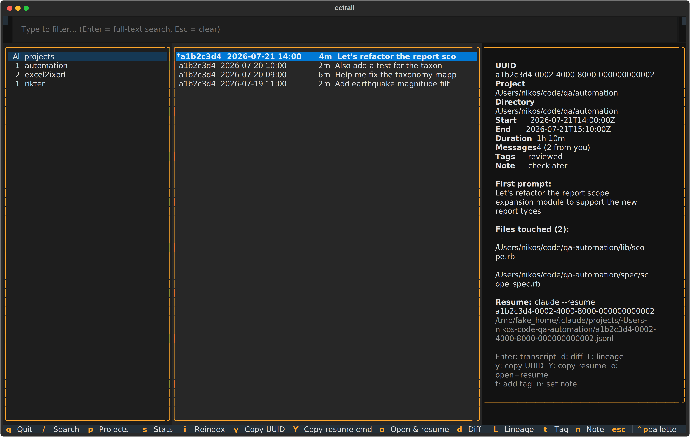

# cctrail — Claude Code Session Tracker

A CLI tool that indexes your local Claude Code session transcripts
(`~/.claude/projects/**/*.jsonl`) into a searchable SQLite database, so you
can find, read, and analyze past sessions without hunting through raw
JSONL files — plus a lazygit-style interactive TUI.

## Install

Requires Python 3.8+.

```bash
git clone <your-repo-url> cctrail
cd cctrail
./install.sh            # core CLI only
./install.sh --tui       # also installs the interactive TUI (pulls in textual)
```

This installs `cctrail` as a command on your `PATH` (via [pipx](https://pipx.pypa.io)
if available, falling back to `pip install --user`).

Prefer to do it by hand?

```bash
pip install .            # or: pip install '.[tui]' for the TUI too
```

Both `cctrail` (console script) and `python -m cctrail` work after install.

### Uninstall

```bash
pipx uninstall cctrail     # if installed via pipx
# or
pip uninstall cctrail      # if installed via pip
```

## Interactive TUI (lazygit-style)

```bash
cctrail tui
```



A three-pane interface: projects on the left, sessions in the middle,
detail view on the right, with a live filter box up top.

| Key       | Action                                                |
|-----------|--------------------------------------------------------|
| `/`       | Focus the search box                                    |
| (typing)  | Live-filters the session list as you type                |
| `Enter`   | Runs a full-text search (in the search box) / opens the full transcript (in the session list) |
| `p`       | Focus the project panel                                 |
| `↑` / `↓` | Move through whichever panel is focused                  |
| `y`       | Copy the selected session's UUID to the clipboard        |
| `Y`       | Copy the `claude --resume <uuid>` command to the clipboard |
| `o`       | Open a new terminal tab, cd into the session's directory, and run `claude --resume` there |
| `d`       | Show git commits/diffstat made during this session's time window |
| `L`       | Show this session's lineage (resume chain / adjacent sessions) |
| `t`       | Add tag(s) to the selected session                       |
| `n`       | Set (or clear) a note on the selected session            |
| `Esc`     | Clear search (if focused there) / focus the list          |
| `s`       | Open the stats overlay                                  |
| `i`       | Reindex (picks up new sessions without leaving)          |
| `q`       | Quit                                                     |

Selecting a project in the left panel scopes the session list to just
that project — combine it with the search box to filter by project *and*
keyword at once. Select "All projects" (top of the list) to clear the
project filter. A `*` before a session's UUID in the list means it has
tags.

The list falls back to a plain substring match if the full-text index
doesn't return anything for very short fragments, so partial words still
work.

### Reading a session (`Enter`)

Opens the full conversation — every prompt, response, and tool call — in
a scrollable overlay. This is also available outside the TUI:

```bash
cctrail view a1b2c3d4
```

### Resuming a session (`y` / `Y` / `o`)

`y` and `Y` try two clipboard mechanisms at once: a terminal OSC-52 escape
(works in most terminals, including over SSH, but **not** macOS
Terminal.app) and a native tool (`pbcopy` / `xclip` / `xsel` / `wl-copy` /
`clip`, which does cover Terminal.app). Whichever lands, you'll get a
notification either way.

`o` opens a new terminal tab/window already `cd`'d into the session's
directory and running `claude --resume <uuid>`. Support depends on what
you're running in:

- Inside **tmux**: opens a new tmux window (works regardless of OS).
- **macOS**: iTerm2 gets a new tab via AppleScript; otherwise a new
  Terminal.app window.
- **Linux**: tries `gnome-terminal`, `konsole`, `xfce4-terminal`, then
  `xterm`, in that order.
- **Windows**: Windows Terminal (`wt`) if installed, else a new `cmd.exe`
  window.

If none of these match your setup, `o` reports why it couldn't open a
terminal rather than failing silently — `y`/`Y` (copy the command
yourself) are the reliable fallback.

The same resume flow is available outside the TUI:

```bash
cctrail resume a1b2c3d4                 # prints + copies the resume command
cctrail resume a1b2c3d4 --open          # also opens a new terminal tab and runs it
cctrail resume a1b2c3d4 --no-copy       # skip the clipboard copy
```

### Git-aware diff (`d`)

If the session's directory is a git repo, shows the commits made during
that session's time window (with a small buffer) plus an aggregate
diffstat. Outside the TUI:

```bash
cctrail diff a1b2c3d4
```

This only looks at commit *timestamps* against the session's time range —
it doesn't try to attribute specific hunks to specific prompts, so treat
it as "what changed in this repo around the time of this session," not a
guaranteed causal link.

### Lineage (`L`)

Shows sessions related to this one — either an explicit parent/child link
if your Claude Code version records one when branching/resuming a
session, or (much more commonly, since that field isn't confirmed to
exist in the current transcript format) a **heuristic** guess: the
nearest session before/after this one in the same directory, only shown
if the gap is under 4 hours. Heuristic results are always labelled as
such — they're a "possibly continues" signal, not a fact. Outside the
TUI:

```bash
cctrail lineage a1b2c3d4
```

### Tags & notes (`t` / `n`)

Personal organization on top of project/search — tag a session
("bugfix", "revisit") or leave yourself a note. Both are filterable and
searchable.

```bash
cctrail tag a1b2c3d4 bugfix important
cctrail untag a1b2c3d4 important
cctrail note a1b2c3d4 "Circle back after the v2 release"
cctrail note a1b2c3d4              # clears the note
cctrail search bugfix --tag bugfix
cctrail list --tag bugfix
```

## Commands

### `cctrail index`
Scans `~/.claude/projects/` (or your configured override) and (re)builds
the local index. Safe to run repeatedly — unchanged transcripts are
skipped, changed ones are re-indexed, ignored projects are skipped
entirely.

```bash
cctrail index
```

### `cctrail watch [--interval N]`
Runs `index` continuously (default: every 30s) instead of you having to
wire up your own cron job. Only prints a line when something actually
changed; Ctrl+C to stop.

```bash
cctrail watch
cctrail watch --interval 10
```

For a persistent background service instead of a foreground loop, wrap
this in a systemd user unit / launchd agent, or fall back to the cron
approach below.

### `cctrail stats`
Overall usage statistics: total sessions, total time, breakdown by
project, day of week, hour of day, token usage (if your transcripts
record it), and your most recent sessions.

```bash
cctrail stats
```

### `cctrail search <keywords...> [--project <substr>] [--tag <tag>]`
Full-text search across every prompt, response, and tool call in your
session history. Uses SQLite FTS5, so it's fast even with thousands of
sessions.

```bash
cctrail search taxonomy mapping bug
cctrail search refactor --project qa-automation
cctrail search "" --tag bugfix   # tag-only filter
```

### `cctrail view <uuid>`
Print the full conversation transcript for a session — every prompt,
response, and tool call, in order.

```bash
cctrail view a1b2c3d4 | less
```

### `cctrail diff <uuid>`
Git commits + diffstat made in the session's directory during its time
window (see "Git-aware diff" above).

### `cctrail lineage <uuid>`
Related sessions — explicit resume-chain link if recorded, otherwise a
labelled time-adjacency heuristic (see "Lineage" above).

### `cctrail tag <uuid> <tag>...` / `cctrail untag <uuid> <tag>` / `cctrail note <uuid> [text]`
See "Tags & notes" above.

### `cctrail projects`
List every project you've used Claude Code in, with session counts and
last-active date.

```bash
cctrail projects
```

### `cctrail resume <uuid> [--open] [--no-copy]`
Print the resume command for a session, copy it to the clipboard, and
optionally open a new terminal tab already `cd`'d into the session's
directory and running it.

### `cctrail show <uuid>`
Full detail for one session — you can pass a UUID prefix instead of the
full UUID (like short git hashes).

```bash
cctrail show a1b2c3d4
```

### `cctrail list [--project <substr>] [--tag <tag>]`
Recent sessions, optionally filtered by project path and/or tag.

```bash
cctrail list --project excel2ixbrl
cctrail list --tag bugfix
```

### `cctrail prune`
Removes indexed sessions whose transcript file no longer exists on disk
(e.g. purged by Claude Code's own retention settings). Doesn't touch
anything on disk — just cleans up stale index entries.

```bash
cctrail prune
```

### `cctrail forget <uuid>`
Removes one session from the local index only — the original transcript
file is untouched. Useful for excluding something sensitive from your
locally searchable database without deleting the actual Claude Code
history.

```bash
cctrail forget a1b2c3d4
```

### `cctrail config` / `cctrail ignore <substr>` / `cctrail unignore <substr>`
Shows the effective config (`~/.cctrail/config.json`), or adds/removes a
project-path substring from the ignore list. Ignored projects are
skipped entirely during indexing — their transcripts are never read.

```bash
cctrail config
cctrail ignore client-acme      # never index anything with "client-acme" in the path
cctrail unignore client-acme
```

You can also hand-edit `~/.cctrail/config.json` directly — it currently
supports:

```json
{
  "claude_projects_dir": null,
  "ignored_projects": []
}
```

Set `claude_projects_dir` if your Claude Code transcripts live somewhere
other than `~/.claude/projects`.

## Automatic indexing on session exit

Three options, roughly in order of how much setup they need:

1. **`cctrail watch`** (see above) — run it in a spare terminal, tmux
   pane, or as a background service. No cron needed.
2. **cron / launchd**, running `index` every few minutes — indexing is
   cheap since it skips unchanged files:

   ```bash
   # crontab -e
   */5 * * * * cctrail index >> ~/.cctrail/index.log 2>&1
   ```
3. **A Claude Code `SessionEnd` hook**, if your installed version
   supports one (check `claude config` / the hooks documentation) —
   trigger `cctrail index` directly for near-instant indexing.

## Project layout

```
cctrail/  # (repo root)
├── pyproject.toml        # package metadata, `cctrail` console script entry point
├── install.sh            # convenience installer (pipx, falls back to pip)
├── src/cctrail/
│   ├── core.py           # DB setup, transcript parsing, index/search/stats/tags/lineage logic
│   ├── cli.py            # argparse entry point (`cctrail.cli:main`)
│   ├── tui.py            # Textual-based interactive UI (`cctrail tui`)
│   ├── terminal.py        # clipboard + new-terminal-tab spawning
│   ├── gitutil.py         # git commit window / diffstat lookup
│   ├── viewer.py          # full-transcript rendering (CLI + TUI)
│   └── config.py          # ~/.cctrail/config.json load/save, ignore-list checks
└── README.md
```

## Known limitations

- **Project path decoding is lossy, but resume directories usually aren't.**
  Claude Code encodes your working directory into the folder name by
  replacing `/` with `-`; if your actual path contains a literal `-` (e.g.
  `qa-automation-tool`), decoding that folder name back is ambiguous. The
  `project` column is a best-effort display value built from this decoding.
  However, `cctrail index` also captures the exact `cwd` recorded inside
  the transcript itself (when your Claude Code version records one), which
  is what `resume`, `y`/`Y`/`o`/`d` in the TUI, and `cctrail show`'s
  "Directory" field actually use — so resuming/diffing works even when the
  displayed project path doesn't perfectly reverse the encoding.
- **Opening a new terminal tab (`o` / `--open`) is best-effort** and
  depends on what terminal/multiplexer you're running — see the TUI
  section above for what's supported. If none match, use `y`/`Y` to copy
  the UUID or resume command instead and paste it into a new tab yourself.
- **Lineage is usually a heuristic, not a fact.** No confirmed field in
  the current Claude Code transcript format records "this session
  continues that one" — `cctrail` looks for a few plausible field names,
  and if none are found, falls back to guessing from same-directory +
  time-adjacency. That fallback is always labelled "heuristic" in the
  output; treat it as a hint to check, not a guarantee.
- **Git diff is time-window-based, not content-based** — it shows commits
  whose timestamps fall in the session's range, not commits provably
  caused by that session's edits.
- **Token usage has no dollar figures attached** — pricing changes over
  time and varies by model, so `cctrail` only reports raw token counts.
  Check docs.claude.com for current pricing if you want to convert.
- **The JSONL transcript format is internal to Claude Code** and can change
  between releases. This tool parses defensively (skips malformed lines,
  tolerates missing fields) but a major format change could still require
  an update to the parser.
- Sessions are only as available as your local retention settings allow —
  if `cleanupPeriodDays` purges old transcripts, they're gone before
  `cctrail index` ever sees them (`cctrail prune` cleans up the index side
  of that after the fact). Run `index` (or `watch`) regularly if you want
  a full history.
